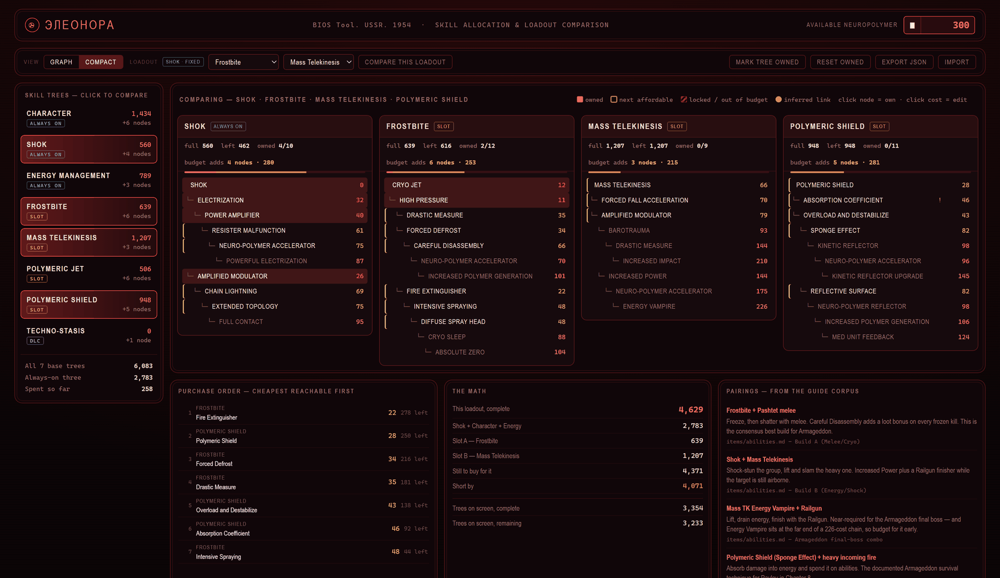

# Atomic Heart

A free hint guide for Atomic Heart, with spoiler levels you control. Get help with this first-person action-RPG set in an alternate 1955 USSR. Your AI agent answers only from the guide files and tracks where you are so you can pick back up.

## Use it

Install the [reader](https://github.com/hintforge/reader) in any AI agent that can read files on your computer, then tell it:

> Load the Atomic Heart guide from github.com/hintforge/atomic-heart

Try "how do I beat this fight", "how does this puzzle work" or "where was I".

The guide uses the [Hintforge](https://github.com/hintforge/builder) format. The agent reads and writes only files you control.

## Spoilers

Enemy warnings run from Tier 0 to 5, puzzle hints from Tier 0 to 3. Both start silent. Raise them when you want more help, up to boss strategy or a puzzle walkthrough.

## What's inside

- Mechanics, zone navigation, enemies, NPCs, items, puzzles and optional zones.
- All 82 achievements across the base game and DLC.
- All 77 base-game skills across seven trees, with Neuropolymer costs and prerequisites. The pictured personal planner compares four trees and purchase orders; it isn't distributed here. A weapon-upgrade planner is still planned.

## Save reader

`save_watcher.py` reads only the plain header of the encrypted save: your zone and equipped glove skills. Even that can hint at later story. Unprompted next-step advice after a save read was fixed in May 2026. Spoiler gating is still being tightened, and leak reports name the affected version.
